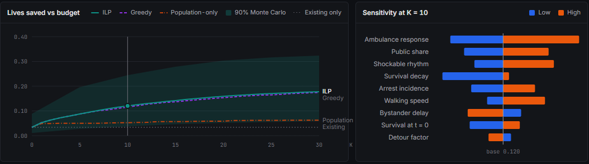

# AED Placement Optimizer

A campus has money for a limited number of defibrillators (AEDs). This project picks where to put them so the most cardiac-arrest patients survive each year, and checks how much that answer depends on numbers we had to guess.

Our study area is York University's Keele campus. The same code also runs on a generated campus, which is what the web app below shows.


## What it does

Give it a budget of K new AEDs and it returns the K sites that maximize expected lives saved per year, measured against waiting for an ambulance. Along the way it accounts for things a plain "cover the most people" model skips:

- **Time of day.** Academic buildings lock at night, residences don't, and the crowd moves around. A site only counts for the periods it's open.
- **Speed matters.** An AED that arrives in 2 minutes is worth far more than one that arrives in 6. Survival falls off exponentially with time, so coverage is graded, not yes/no.
- **Existing AEDs.** They're always in the plan and take up no budget.
- **Uncertainty.** Monte Carlo runs and a one-at-a-time sensitivity test show how the plan holds up when incidence, walking speed or ambulance time are off.

## The app

The app is in `web/`. Drag the budget slider and the ILP re-solves in your browser (HiGHS compiled to WebAssembly), so there's no server.


Switching the time of day changes which sites are open and who is on campus, so coverage and the lives-saved split change with it.


Below the map, the K-curve shows lives saved against budget for the ILP, greedy and a population-only baseline, with the Monte Carlo 90% band. The tornado chart shows which assumptions move the answer most.



Run it:

```bash
cd web
npm install
npm run dev
```

The "Team results" dataset shows the precomputed Python results for a generated campus of 30 buildings, drawn on top of the Keele map. The positions and headcounts are illustrative, not measured York data, and the app says so in its sidebar. "Random grid" generates a fresh campus from a seed and solves it live.

## How it works

1. **Campus.** The campus is a grid of cells, each with expected cardiac arrests per year for each period, plus a list of candidate AED sites with a cost, an in-building delay and opening hours.
2. **Travel time.** For each cell and site: dispatch delay, plus a round-trip walk to fetch the AED, plus the delay getting into the building.
3. **Benefit.** If shocked at time t, survival is `S0 * exp(-k t)`. An AED arriving within a time band is worth the survival it adds over the ambulance, times the share of arrests that are shockable.
4. **Coverage rows.** Each row is one cell, in one period, in one time band. It has a weight (lives per year at stake) and a list of sites that reach it in time and are open.
5. **Solve.** An integer program picks sites to maximize the weight of covered rows within the budget. HiGHS solves it through `scipy.optimize.milp`, and the web app runs the same model in JavaScript. Greedy and swap heuristics are included for comparison.
6. **Test.** Re-score the plan under random draws of the uncertain inputs.

On the generated campus, with 10 new AEDs the ILP saves 0.120 lives per year against 0.034 for the existing AEDs alone. Greedy gets 0.116 and a population-only placement gets 0.052, because it stacks AEDs in the busiest buildings and ignores the clock. Those numbers are small because a campus sees about five public arrests a year.

The York model replaces the generated campus with OpenStreetMap buildings, entrances and walking paths, York's published classroom seats and residence beds, and the 19 AEDs on York's own map. On it, the 19 published AEDs score about 0.095 lives per year in the base case and the best 19 sites anywhere score about 0.170. That gap ranges from +43% to +106% across the structural scenarios we tried, and it comes from modeled occupancy, so read it as a direction and not a measurement. Some of those ILP runs hit their 60-second limit, so the best-site figures are lower bounds.

For the full walkthrough, see [HOW_IT_WORKS.md](HOW_IT_WORKS.md). The equations are in [docs/model.md](docs/model.md) and every guess we made is numbered in [docs/assumptions.md](docs/assumptions.md).

## Running the Python side

Python 3.11 or newer.

```bash
pip install -r requirements.txt
python -m pytest -q
python experiments/run_all.py --seed 0 --n 200      # K-curve, Monte Carlo, sensitivity -> results/
python experiments/york_validation.py --out results # published vs best York placements
python web/scripts/export_data.py --seed 0          # refresh the app's data
```

`run_all.py` defaults to the York campus. Pass `--campus synthetic` for the generated one, which is what the app's "Team results" use.

## Layout

| Path | Contents |
| --- | --- |
| `aed/` | The model: data loaders, travel time, survival, coverage, solvers, uncertainty |
| `aed/data/york.py` | Keele campus loader built from `data/york/` |
| `experiments/` | Scripts that write the results CSVs and the York validation |
| `web/` | The browser app (TypeScript, Vite, Leaflet, HiGHS in WASM) |
| `data/york/` | OpenStreetMap extracts, York AED list, classrooms, residences, and their [sources](data/york/SOURCES.md) |
| `docs/` | Model, assumptions, interfaces, results log |
| `tests/` | pytest suite |

## Limits

- Occupancy is estimated from floor area, classroom seats and residence beds. York doesn't publish a timetable or headcounts, so the York numbers rest on assumptions 14 to 22.
- Walking uses the mapped OpenStreetMap network. Indoor routes and tunnels aren't mapped.
- York's AED map may be incomplete, so "published" means published.
- Incidence is an adult figure applied to a young campus, which probably overstates risk.

Map data (c) OpenStreetMap contributors, ODbL 1.0.
