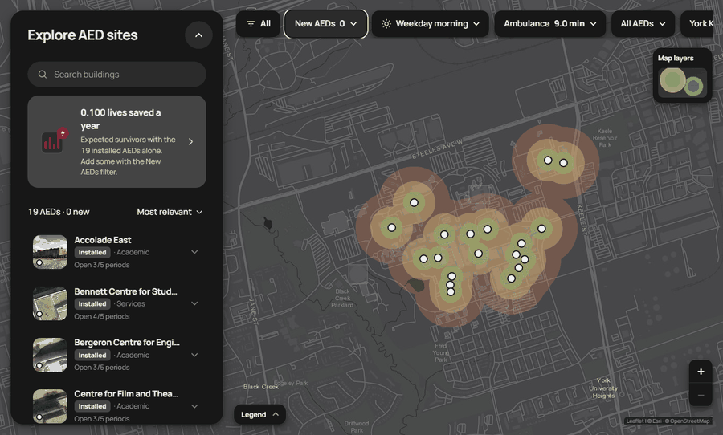
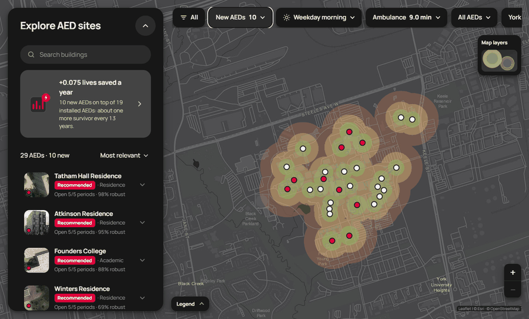
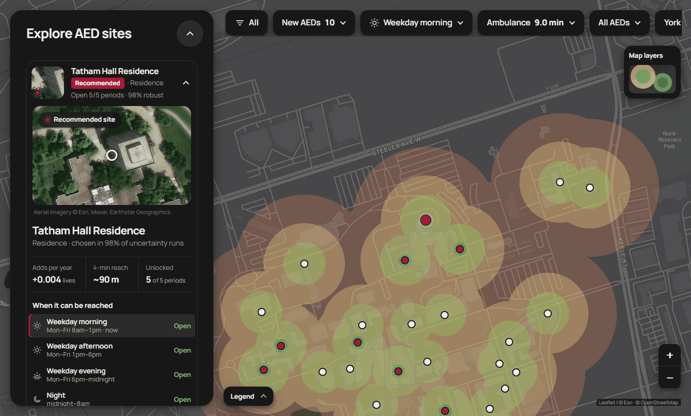
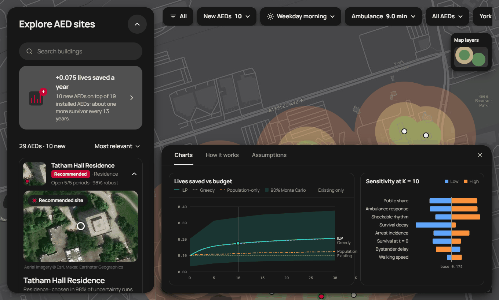
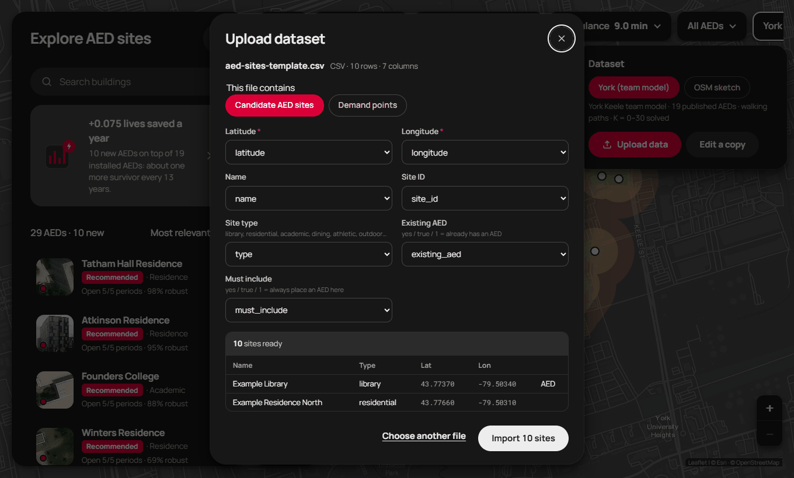

# AED Placement Optimizer

A campus has money for a limited number of defibrillators (AEDs). This project picks where to put them so the most cardiac-arrest patients survive each year, and checks how much that answer depends on numbers we had to guess.

Our study area is York University's Keele campus: 86 OpenStreetMap buildings, York's 19 published AEDs, and walking paths. The model also runs on a generated campus, which we used to build and test it.


## What it does

Give it a budget of K new AEDs and it returns the K sites that maximize expected lives saved per year, measured against waiting for an ambulance. It accounts for things a plain "cover the most people" model skips:

- **Time of day.** York is modeled in five weekly periods (weekday morning, afternoon and evening, night, weekend). Academic buildings lock at night and on weekends, residences don't, and the crowd moves around. A site only counts for the periods it's open.
- **Speed matters.** An AED that arrives in 2 minutes is worth far more than one that arrives in 6. Survival falls off exponentially with time, so coverage is graded, not yes/no.
- **Existing AEDs.** York's 19 are always in the plan and take up no budget.
- **Uncertainty.** Monte Carlo runs and a one-at-a-time sensitivity test show how the plan holds up when incidence, walking speed or ambulance time are off.

## The app

The app is in `web/`. The map fills the page. A list of AED sites sits on the left, scenario pills run across the top, and the ILP re-solves in your browser (HiGHS compiled to WebAssembly) whenever you change one, so there's no server. Red pins are recommended sites and white pins are York's installed AEDs. The colored rings show how far a bystander can fetch an AED and get back within 2, 4 or 6 minutes. The card at the top of the list gives the headline, such as "+0.075 lives saved a year" for 10 new AEDs on top of the 19 installed ones.


The "New AEDs" pill sets the budget from 0 to 30. Here it's swept across that range.



The time-of-day pill switches between the five periods. Sites in locked buildings turn gray, and the rings shrink to what the open sites can reach. The "Ambulance" pill moves the response time from 7 to 12 minutes, and the other pills filter the list to recommended or installed sites and switch datasets.



Each site in the list opens into a card with a landmark photo (Wikimedia Commons, credited in the app) or Esri aerial imagery, the lives it adds per year, its 4-minute reach, and whether it's open in each period. The "robust" figure is the share of Monte Carlo runs that picked the site. You can search by building name and sort by relevance, name, hours or robustness.



The summary card opens the Insights sheet, with charts for lives saved against budget (ILP, greedy and a population-only baseline, with the Monte Carlo 90% band) and a tornado chart of which assumptions move the answer most. The same sheet has a short "How it works" and the full assumptions table.



You can also load your own data. Upload a CSV, GeoJSON or KML file of candidate sites or demand points, map its columns, and the app solves on your campus. "Edit a copy" turns the map you're looking at into an editable dataset. Templates are in `web/public/samples/`.



Run it:

```bash
cd web
npm install
npm run dev
```

"York (team model)" shows the precomputed Python results. "OSM sketch" is a quick version built in the browser from OpenStreetMap buildings alone. The app labels it "not the team model", and its numbers aren't comparable.

## How it works

1. **Campus.** The campus is a grid of cells, each with expected cardiac arrests per year for each period, plus a list of candidate AED sites with a cost, an in-building delay and opening hours.
2. **Travel time.** For each cell and site: dispatch delay, plus a round-trip walk to fetch the AED along the mapped paths, plus the delay getting into the building.
3. **Benefit.** If shocked at time t, survival is `S0 * exp(-k t)`. An AED arriving within a time band is worth the survival it adds over the ambulance, times the share of arrests that are shockable.
4. **Coverage rows.** Each row is one cell, in one period, in one time band. It has a weight (lives per year at stake) and a list of sites that reach it in time and are open.
5. **Solve.** An integer program picks sites to maximize the weight of covered rows within the budget. HiGHS solves it through `scipy.optimize.milp`, and the web app runs the same model in JavaScript. Greedy and swap heuristics are included for comparison.
6. **Test.** Re-score the plan under random draws of the uncertain inputs.

Occupancy comes from floor area, 16,008 classroom seats and the beds in York's residence handbook, because York doesn't publish headcounts. That gives about 3.7 public arrests a year on campus.

### York results

York's 19 published AEDs save an expected 0.100 lives per year. Adding new AEDs on top of them:

| New AEDs | ILP | greedy | population-only |
| --- | --- | --- | --- |
| 0 | 0.100 | 0.100 | 0.100 |
| 5 | 0.157 | 0.157 | 0.109 |
| 10 | 0.175 | 0.173 | 0.113 |
| 20 | 0.194 | 0.193 | 0.119 |
| 30 | 0.206 | 0.205 | 0.125 |

Greedy stays within about 1% of the ILP. Population-only placement stacks AEDs in the busiest buildings: at K = 10 it adds 0.013 lives per year, against 0.075 for the ILP. The K = 10 plan holds up under Monte Carlo (200 runs): 0.156 lives per year, with a 90% interval of 0.060 to 0.335.

We also asked how good York's current layout is. Keeping 19 AEDs but placing them anywhere, the model's best layout beats the published one by 74% in the base case, and by 38% to 99% across the plausible scenarios we tried (a footpaths-only run gives 129%, inflated because indoor routes aren't mapped). Most of the gain comes from moving AEDs to residences and busy college buildings. Winters, Founders and McLaughlin colleges, Atkinson, the Sherman Health Science Research Centre and Pond Road Residence all sit more than a 3-minute walk from a published AED. These gains come from modeled occupancy, so read them as a direction and not a measurement, and York's map may omit AEDs that exist.

The tables and sensitivity figures are in [docs/results-log.md](docs/results-log.md). For a plain-language walkthrough of the optimization, see [HOW_IT_WORKS.md](HOW_IT_WORKS.md). The equations are in [docs/model.md](docs/model.md) and every guess we made is numbered in [docs/assumptions.md](docs/assumptions.md).

## Running the Python side

Python 3.11 or newer.

```bash
pip install -r requirements.txt
python -m pytest -q
python experiments/run_all.py --seed 0 --n 200 --out results/york     # K-curve, Monte Carlo, sensitivity
python experiments/york_validation.py --out results/york               # published vs best York placements
python experiments/pitch_figures.py                                    # pitch charts -> results/york/figures/
python web/scripts/export_data.py --seed 0                             # refresh the app's data
```

`run_all.py` defaults to the York campus. Pass `--campus synthetic` for the generated one. `app.py` is an earlier Streamlit demo of the same model (`streamlit run app.py`). The web app replaced it.

## Layout

| Path | Contents |
| --- | --- |
| `aed/` | The model: data loaders, travel time, survival, coverage, solvers, uncertainty |
| `aed/data/york.py` | Keele campus loader built from `data/york/` |
| `experiments/` | Scripts that write the results CSVs, the York validation and the pitch figures (`pitch_figures.py`) |
| `results/york/` | Committed York results the app reads |
| `web/` | The browser app (TypeScript, Vite, Leaflet, HiGHS in WASM) |
| `data/york/` | OpenStreetMap extracts, York AED list, classrooms, residences, and their [sources](data/york/SOURCES.md) |
| `docs/` | Model, assumptions, interfaces, results log |
| `tests/` | pytest suite |

## Limits

- Occupancy is estimated, not counted, so the York numbers rest on assumptions 14 to 22.
- Walking uses the mapped OpenStreetMap network. Indoor routes and tunnels aren't mapped.
- York's AED map may be incomplete, so "published" means published.
- Incidence is an adult figure applied to a young campus, which probably overstates risk.

Map data (c) OpenStreetMap contributors, ODbL 1.0.
